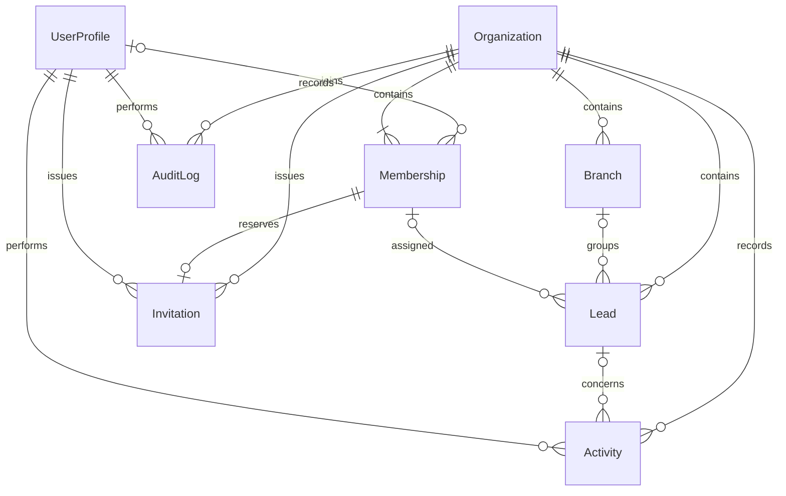

# EstateOS SQL Connect foundation

The relational foundation contains eight models and authorized server services. Phase 3A adds Invitation/AuditLog, REMOVED state and lower-role changes; see [Multi-tenancy](MULTI_TENANCY.md). [Company onboarding](ONBOARDING.md) adds registration, settings, switching and nullable company fields; [Leads](LEADS.md) connects lead UI/operations. [Team](TEAM.md) connects member settings and configurable secure email invitations. Branch administration and complete member lifecycle UI remain future work. Dashboard analytics retain empty states. EstateOS is not production-ready.

The schema lives in `dataconnect/schema/` and stored operations in `dataconnect/connector/`. The connector directory was renamed from `example`; its configured connector ID remains `example`, so no hosted connector rename or schema migration is needed for that folder change. Firebase SQL Connect compiles these sources into PostgreSQL tables and a generated Admin Node SDK. There is no Prisma installation, second ORM, or separate application database layer. Normal application calls use that SDK with a verified Firebase user's identity impersonated; possession of an Admin SDK instance is not treated as end-user authorization.

## Relationships and identifiers



| Model | Key and purpose |
| --- | --- |
| `Organization` | UUID tenant identifier, organization name and lifecycle timestamps. |
| `UserProfile` | Firebase Authentication UID as its string key; verified identity metadata and an optional active organization selection. A profile does not grant membership or a role. |
| `Membership` | Composite `(organizationId, id)` key, with a UUID membership identifier. Links a profile to an organization after invitation acceptance and records the authoritative role and membership status. Unaccepted invitations have no bound profile. |
| `Invitation` | Composite tenant/UUID key; same-company membership reference, unique token hash, recipient/role, issuer, expiry and acceptance/revocation state. |
| `Branch` | Composite `(organizationId, id)` key with a UUID branch identifier. A branch belongs to one organization. |
| `Lead` | Composite `(organizationId, id)` key with a UUID lead identifier. Optional branch and assignee references share the lead's organization identifier. |
| `Activity` | Composite `(organizationId, id)` key with a UUID event identifier. Records the verified actor, action and optional lead relationship within one organization. |
| `AuditLog` | Separate tenant/UUID-keyed security event with verified actor, action, target type/UUID, timestamp and safe metadata. |

Tenant-owned relations reuse `organizationId` in their foreign keys. A lead cannot reference a branch or assigned membership from another organization, and an activity cannot reference another organization's lead. The same bare UUID is never sufficient to identify a tenant-owned record. The database additionally prevents duplicate profile memberships within one organization. SQL Connect can return UUID strings as 32 hexadecimal characters; service validation accepts that form and canonical dashed UUIDs, normalizing comparisons while keeping Firebase UIDs case-sensitive. Timestamps are UTC server values; mutation operations explicitly update `updatedAt` rather than trusting a submitted clock value.

Indexes support membership lookups by profile/status, organization membership lists, branch lists, lead lists by organization/status/assignment, and chronological activity retrieval. Unique organization/email and organization/profile constraints protect membership identity. The GraphQL schema is the source for indexes and foreign keys; do not add ad hoc `ALTER TABLE` or `CREATE INDEX` changes outside SQL Connect's managed migration workflow.

Deleting organizations, profiles, or tenant records is deliberately absent from the application operations. The generated PostgreSQL schema may have cascading reference behavior; do not use unrestricted Admin deletion helpers as a substitute for a reviewed retention and deletion workflow.

## Identity, organization scope and permissions

Normal tenant calls obtain a fresh verified Firebase session and use identity impersonation. RecordInvitationDelivery is the narrow NO_ACCESS server-only exception; its transaction verifies actor/tenant/issuer/digest binding before writing provider receipts. Clients cannot invoke it. See [Team](TEAM.md). Client-supplied role values, profile UIDs, email-verification flags, or authentication claims are never used to establish authority.

The selected organization is a preference in `UserProfile`, not a security grant. Switching organizations requires an active membership in the requested organization. Every later operation verifies active membership again; an old selection does not preserve access after suspension or revocation. Tenant methods derive scope from the selected organization rather than accepting an arbitrary organization as authority. Operation-level authorization also protects direct connector invocation.

The authoritative role is stored on `Membership`:

| Capability | OWNER | ADMIN | MANAGER | AGENT |
| --- | --- | --- | --- | --- |
| Read the selected organization and branches | Yes | Yes | Yes | Yes |
| Read membership lists and organization activity | Yes | Yes | No | No |
| Create/read/update all organization leads | Yes | Yes | Yes | No |
| Create/read/update leads assigned to oneself | Yes | Yes | Yes | Yes |
| Create branches | Yes | Yes | No | No |
| Invite/approve/manage MANAGER and AGENT memberships | Yes | Yes | No | No |
| Invite/approve/manage ADMIN memberships | Yes | No | No | No |
| Create or grant OWNER in an existing organization | No | No | No | No |
| Change one's own role or membership status | No | No | No | No |

This first schema provides organization isolation and assignment-based agent lead access. Active owners, administrators and managers have organization-wide lead access. Active agents can read/update only leads assigned to their own membership and must assign newly created leads to themselves. The same restriction is enforced by stored operations for direct connector calls. Branch-based restrictions, approved sharing, more granular record permissions, and owner transfer remain future work. A branch relationship alone is not an access-control rule.

Organization creation is a dedicated transactional bootstrap: a verified user creates a new organization, receives its fixed `OWNER`/`ACTIVE` membership, selects it, and records an audit event atomically. It cannot attach an owner to an existing organization or accept a caller-selected owner role. If any step fails, the organization and its associated writes roll back together.

## Invitations and membership lifecycle

1. An authorized owner or administrator creates an `INVITED` membership for a normalized email and an allowed role. Owner invitations are unavailable; only an owner may invite an administrator.
2. The server creates a 256-bit secret, stores its SHA-256 digest and enforces configurable 1–168-hour expiry. Resend delivery is configurable; an unset provider yields an explicitly unsent preview only in development. Production fails closed without provider setup. No public recipient lookup or raw-token audit metadata exists.
3. A signed-in user with the matching verified email accepts the invitation by presenting its organization identifier, membership identifier and token. The connector checks the separate Invitation's email, digest, expiry and state in the same transaction that binds the current profile. Acceptance rechecks current issuer authority and atomically marks the invitation ACCEPTED, binds the verified UID, activates membership, selects the company and audits the event. Legacy membership digests alone are insufficient; follow the Phase 3A migration runbook before rolling out acceptance.
4. ApproveMembership remains only for legacy PENDING records and requires the authorized hierarchy. New acceptance does not wait for second approval. Do not bulk-activate legacy records during migration.
5. Authorized membership administration can suspend or remove eligible memberships; legacy `REVOKED` remains supported. `INVITED`, `PENDING`, `SUSPENDED`, `REMOVED` and `REVOKED` never qualify for tenant data access. Pending Invitation rows are revoked when their membership is suspended/removed. Existing owners cannot be removed or demoted, and self-administration is forbidden. Replaying an accepted invitation fails. Sensitive writes append a separate AuditLog while preserving the Activity timeline.

The unique organization/profile relationship prevents accepting a second invitation as a duplicate membership. Role-setting endpoints require verified administrator authority, CSRF and tenant checks. Profile upserts and custom claims grant no role. Pending invitations support reissue/revocation. ReinviteRevokedInvitation can renew a revoked, never-accepted unbound reservation with a fresh digest and audit event, preserving the existing role; it cannot reactivate a previously accepted member. Owner transfer, account merging, reactivation of previously accepted removed members and domain-based auto-join remain future work.

## Validation and audit events

Server services validate identifiers, bounded text, email normalization, enumerations, pagination and invitation token shape before invoking the SDK. Connector operations independently require verified authentication, query authoritative membership state, check permitted roles and restrict rows by organization. Multi-step writes and their activity events use SQL Connect `@transaction` with `@check`; failed checks roll back writes. Sensitive membership checks are redacted from responses.

Tenant mutations first conditionally update the actor's already-`ACTIVE` membership to the same status. This acquires a PostgreSQL row lock so revocation and an authorized write cannot pass one another between the permission check and commit. Lead writes also lock a different active assignee; self-assignment reuses the actor's lock because PostgreSQL must not update the same row twice in one data-modifying CTE statement. These authorization locks do not change membership timestamps or emit business audit events. Concurrent conflicts can reject a transaction; callers must handle the sanitized conflict/error and retry deliberately.

Activities and separate AuditLog records are written atomically for organization creation/switching, invitations and membership changes, branch creation, lead creation/updates, notes, status, assignment and follow-up changes. Actor identities and event timestamps come from the verified request context. Connector APIs expose no arbitrary audit update/delete operation. Audit metadata contains identifiers and safe state transitions, not credentials, invitation tokens or contact text. User-authored lead notes have a separate bounded `Activity.note` column and are readable only through an authorized lead timeline. AuditLog excludes note text. Independent retention/export and tamper-evident archival remain release work.

Services remain server-only. The connected Leads HTTP boundary adds session verification, exact-origin and CSRF checks, bounded strict JSON and a selected-company consistency header. A hidden form, disabled control or client-side role check is insufficient. Future route handlers, server actions, webhooks and background jobs must preserve these service protections. Do not import the unrestricted generated Admin SDK into client components.

The organization service exports `upsertMyProfile`, `listMyOrganizations`, `createOrganization`, `switchOrganization`, `getCurrentOrganization`, `listBranches`, `createBranch`, `listMemberships`, `inviteMembership`, `acceptInvitation`, `approveMembership`, `setMembershipStatus`, `setMembershipRole`, `listInvitations`, `listAuditLogs` and `listActivities`. The lead service additionally connects stored search, count, detail, active assignee and timeline queries plus creation, full contact updates, status, assignment, notes and follow-up mutations. The Leads module's protected HTTP routes call this service boundary and never accept a client-selected identity or authoritative role.

Company onboarding initializes a missing profile before organization creation. Invitation acceptance initializes a missing profile inside the same transaction as token consumption, ACTIVE membership, workspace selection and audit; invited users do not need company onboarding or a separate profile-creation step. The optional initial display name is derived from the verified session by the server, and an existing profile name is preserved. Standalone `upsertMyProfile({ displayName })` derives UID and verified email from the session and cannot accept membership roles. Other tenant operations still require a profile (`PROFILE_REQUIRED`, 409) and an authorized company selection (`ORGANIZATION_REQUIRED`, 409). All tenant services derive the selected organization and verify membership again. `createLead` defaults an agent's missing assignment to that agent's own membership. `updateLead` is a full-record contact/reference update: omitted optional contact and reference fields are cleared. Follow-up is preserved by contact edits and changed only through its dedicated operations. Callers must preserve intended fields rather than treating a full update as a partial patch. Provider failures are mapped to safe application errors; raw SQL/provider errors are not exposed to users.

## Existing service configuration

If login succeeds but the workspace reports a missing company database service,
the configured connector or stored operations may not exist on the selected
backend. Local files in `dataconnect/.dataconnect/` are generated schema
artifacts, not a deployed service. Missing profiles/memberships return null or
empty lists; they are not provider-level resource 404s.

For local application development, stop the current Next.js server and run:

```powershell
npm.cmd run dev:local
```

This starts only the SQL Connect emulator, with a persistent local PostgreSQL
directory at `.tmp/sql-connect-local/data`, then starts Next.js on port 3000.
The CLI supplies `DATA_CONNECT_EMULATOR_HOST=127.0.0.1:9399` to that child
process. Existing Firebase Authentication remains configured normally; no
authentication emulator or dummy company fixtures are enabled. Keep this
terminal open. Real company onboarding starts from an empty local membership
list. Integration-test/reset data uses a separate directory and ports.

`npm run dev` keeps its previous routing behavior: without an emulator host it
uses the hosted connector. No automatic local fallback occurs on failures.
Hosted use requires a reviewed schema/connector rollout and correct Firebase
project/service/region. Follow the migration runbook before making cloud changes.

The existing Firebase setup uses service `estateos` in `us-east4`, PostgreSQL database `fdcdb`, and the configured Cloud SQL instance identifier `estateos-fdc`. These identifiers describe configuration, not proof that cloud resources exist. This change does not create a Cloud SQL instance, enable billing, migrate a remote database or deploy a connector.

The original movie-review starter schema and its public sample operations are replaced locally. Admin Node generation is retained for server services; a browser CRM SDK is unnecessary for the current architecture. Review the configuration before any future deployment. A UAE-targeted service currently configured in a US region needs an explicit data residency and hosting decision before customer data is collected.

Authentication keeps the variables documented in [AUTHENTICATION.md](AUTHENTICATION.md). SQL Connect uses the same server-only Firebase Admin application and the generated connector's service/location identifiers. Never expose service-account credentials as `NEXT_PUBLIC_*` variables.

For local database work, set `DATA_CONNECT_EMULATOR_HOST` to the loopback address/port used by the emulator, for example `127.0.0.1:9399`. The server bridge rejects emulator routing in production and rejects non-loopback emulator hosts. An unset emulator variable means the SDK targets its configured hosted service; do not use production data for local tests.

## Local development and validation

Use Node.js 24.12 or later and the Firebase CLI available on `PATH`. On PowerShell, `.cmd` avoids the system's `npm.ps1` execution-policy restriction. Commands are run from the repository root:

```powershell
npm.cmd install
npm.cmd run sql:validate
npm.cmd run sql:generate
npm.cmd test
npm.cmd run test:dataconnect
npm.cmd run lint
npx.cmd tsc --noEmit
npm.cmd run build
```

`sql:validate` and `sql:generate` use `scripts/sql-connect-toolkit.mjs`, a wrapper around the official SQL Connect compiler/toolkit supplied by the installed Firebase CLI. Compilation runs offline without a project identifier: the Firebase CLI's normal compile flow can fetch deployed metadata when a project is supplied, which is unnecessary for local schema validation and fails against an intentionally nonexistent demo project. The wrapper uses the official compiler, reports compile failures, and does not implement a separate schema validator. If the toolkit is not installed, obtain the local emulator/toolkit with `firebase.cmd setup:emulators:dataconnect`, then retry. This downloads local development tooling; it does not provision a database.

The emulator scripts explicitly use the local `demo-estateos` project rather than relying on the directory's live Firebase alias. `npm test` runs authentication, tenant and Leads validation/request-boundary tests; `test:dataconnect` separately starts a disposable emulator using `firebase.test.json` on port `19499` (PostgreSQL port `19432`) and runs the stored-operation integration suite. It uses a dedicated `.tmp/sql-connect-integration/data` directory. No cloud resource is needed for these commands. Firebase CLI 15.34.0 can log `ECONNRESET` during emulator shutdown after reporting a successful script; assess the test summary and command exit status, rather than that shutdown message alone.

The generated SDK must be regenerated whenever the schema or stored operations change. Keep its types and runtime files in sync with the connector source. A successful TypeScript check alone does not validate deployed GraphQL authorization.

The seed file is `dataconnect/seed_data.gql`, outside deployable connector directories. It contains synthetic local fixtures only; no hardcoded Firebase production accounts or default privileged application users are introduced. Emulator seeds can use unrestricted administrative setup to establish test roles, but normal integration-test calls must impersonate individual fixture users to exercise connector rules. Never move a seed/reset mutation into a deployable connector.

For manual fixture exploration, start the emulator in one terminal:

```powershell
npm.cmd run sql:emulators
```

In another terminal, seed its default port:

```powershell
$env:DATA_CONNECT_EMULATOR_HOST = "127.0.0.1:9399"
npm.cmd run sql:seed
```

The seed command resets the eight local tables before loading deterministic synthetic fixtures; it is destructive to that disposable emulator data. The script refuses remote hosts, production mode, and a project other than `demo-estateos`. It does not load `.env.local` or cloud credentials. If a project variable is already set in the terminal, use a separate local-development terminal configured for `demo-estateos`. Stop the emulator when finished; remove the emulator environment variable before a later intentional hosted invocation.

The integration runner refuses to fall back to a hosted service when the emulator is unavailable. The emulator is a local PostgreSQL-compatible test environment; live Cloud SQL/IAM behavior still requires a separately approved staging check.

Manual emulator review should verify:

- A verified account creates an organization with exactly one active owner and an organization-created event. A failed bootstrap leaves no partial organization or membership.
- A user belonging to two fixture organizations can select either; an outsider cannot select either organization. Suspension/revocation blocks subsequent calls even if the active selection still points there.
- Each role follows the permission table. An agent cannot invite an administrator, an administrator cannot invite/approve another administrator, and no user can promote themselves.
- An invitation requires the matching verified email, unexpired correct token, and `INVITED` state. Acceptance activates and selects the company atomically after current issuer authority is checked. Wrong email, token, expiry, duplicate membership and replay all fail without partial writes.
- Reads and writes cannot cross tenant boundaries by changing organization, record, branch, assignee or lead identifiers. Database composite foreign keys reject invalid relationships even in administrative fixture setup.
- Lead and membership mutations record the correct actor and event once; unauthorized attempts create neither business writes nor successful audit events.
- Anonymous, unverified, invited, pending, suspended and revoked actors cannot access tenant records by calling stored operations directly.

## Migration plan

### Local transition from the generated starter

1. Preserve any existing work and inspect the current `firebase.json`, service/region, connector configuration and schema. The starter `User`, `Movie`, `MovieMetadata`, and `Review` records are not CRM records; there is no automatic mapping to the CRM models. For an existing CRM database, use the additive [Phase 3A migration steps](MULTI_TENANCY.md#migration-and-rollout) instead of replacing its schema or data.
2. Replace the local starter schema and all sample operations together. Public movie endpoints must disappear from the selected connector, rather than remain available because the application stopped importing them.
3. Compile to inspect the generated relational schema and verify primary keys, tenant foreign keys, unique constraints and indexes. Generate the Admin SDK and remove stale sample SDK files/imports.
4. On a disposable local emulator, initialize the new schema and run the local seed and integration suite. If persistent emulator state contains starter data, stop the emulator and back up or intentionally reset that disposable local state before rebuilding it. Do not issue destructive reset commands against an unverified path or remote host.
5. Run authentication tests, connector/tenant integration tests, lint, TypeScript and the production build. Review the generated changes and commit schema, connector, SDK, tests and docs together.

### Future hosted migration: separate approval required

No hosted migration or deployment is performed by this task. The following is a reviewable runbook for a future authorized staging/release operation:

1. Select the intended Firebase project explicitly with `--project <project-id>`; confirm its existing service, region, database, connectors and billing context. Revisit the current `us-east4` location before placing UAE customer data there. Provisioning a database, enabling paid resources and deploying require approval.
2. Capture and verify a restorable database backup/export. Identify any existing starter or customer records and their consumers. Plan maintenance or an additive rollout if clients still rely on old operations. Never assume sample tables are empty.
3. After approval for any required API/service enablement, run `firebase.cmd dataconnect:services:list --project <project-id>` and `firebase.cmd dataconnect:sql:diff --service estateos --project <project-id>`. Save the proposed DDL with the release. Confirm tenant composite foreign keys, uniqueness, indexes, defaults and nullability. `sql:diff` previews database DDL changes; it does not validate application role logic. Firebase CLI 15.34.0 also ensures the SQL Connect and Cloud SQL Admin APIs are enabled during services:list and sql:diff, so it must not be treated as a purely offline or guaranteed read-only command.
4. Keep the configured `COMPATIBLE` schema validation for an existing database. Review each required migration and any proposed destructive change. `STRICT` can drop tables/columns absent from the application schema. Do not use `--force` to skip migration review. Preserving old sample tables is distinct from preserving their exposed connector operations.
5. After explicit approval of the concrete migration and backup/recovery plan, run `firebase.cmd dataconnect:sql:migrate --service estateos --project <project-id>` interactively and then deploy the reviewed schema/connector, for example `firebase.cmd deploy --only dataconnect:estateos --project <project-id>`. These commands may modify paid cloud resources; they are not local validation steps.
6. Deploy application code with the matching generated SDK. In a staging environment, test real Firebase identities, service IAM, membership and invitation boundaries, cross-tenant operations, atomic audit events and revoked sessions. Verify old public sample operations are unavailable and no unexpected connector remains deployed.
7. Record the project, release/schema commit, migration output, approvals, backup identifier, checks and operational owner. Do not copy credentials into migration records. Enable appropriate monitoring and complete restore/incident exercises before a production release.

Rollback is not a reverse migration guarantee. Redeploying an older compatible connector/application may restore behavior, but cannot recover deleted columns or rows. For a destructive failure, restore the verified backup into an approved recovery target and reconcile writes made after the backup. For later changes, prefer add/backfill/dual-compatible release/remove over renaming or dropping required columns in one deployment. Owner transfer, deletion/retention, tenant export and immutable audit retention need their own migration and authorization designs.

## Official references

- [Schema design](https://firebase.google.com/docs/sql-connect/schemas-guide) and [GraphQL directives](https://firebase.google.com/docs/reference/sql-connect/gql/directive).
- [Authorization and security](https://firebase.google.com/docs/sql-connect/authorization-and-security) and [transactional mutations](https://firebase.google.com/docs/sql-connect/mutations-guide).
- [Admin Node SDK](https://firebase.google.com/docs/sql-connect/admin-sdk) and [SQL Connect emulator](https://firebase.google.com/docs/sql-connect/data-connect-emulator-suite).
- [Schema and connector migrations](https://firebase.google.com/docs/sql-connect/manage-schemas-and-connectors) and [CLI reference](https://firebase.google.com/docs/sql-connect/cli-reference).
